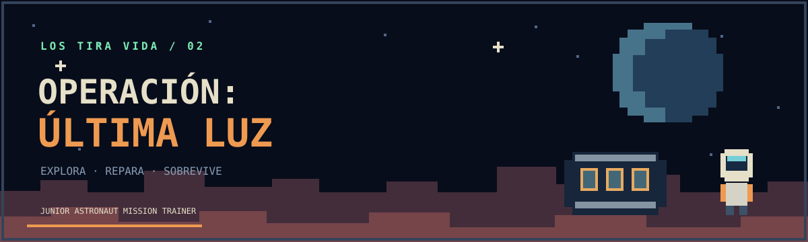
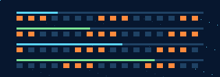

<div align="center">



# LOS TIRA VIDA / 02

**JUNIOR ASTRONAUT · EXPEDICIÓN A MARTE**

`EXPLORA · EXCAVA · CONSTRUYE · SOBREVIVE`


</div>

```text
ESTACIÓN ORBITAL / CONTROL DE EXPEDICIONES
DESTINO ........ MARTE
ZONA ........... REFUGIO JEZERO
TRIPULACIÓN .... 1 ASTRONAUTA
ORDEN .......... BAJAR. SOBREVIVIR. REGRESAR.
```

Una aventura de supervivencia en **vista lateral**, con terreno de bloques que puedes excavar y modificar. Prepara tu equipo desde la estación orbital, baja a Marte y convierte los materiales del planeta en herramientas para seguir vivo.

## 🎮 Primera expedición

La primera versión incluye una misión completa en Marte para **un jugador**. La estación orbital permite elegir suministros y continuar una partida guardada. Los siguientes destinos y el cooperativo quedan fuera de esta versión.

1. **Recolecta:** excava regolito, hierro, cobre, hielo y cristales en la superficie y las cuevas.
2. **Restaura:** fabrica un reciclador para que el refugio vuelva a proporcionar oxígeno.
3. **Mejora:** construye un taladro capaz de romper los cristales densos.
4. **Explora:** fabrica un transmisor y llévalo a la antena de la meseta este.
5. **Regresa:** vuelve al módulo de ascenso del refugio y completa la extracción.

Construye bloques para cruzar obstáculos, fabricar escalones o cubrirte. Vigila oxígeno, energía, salud y temperatura. La estación de recarga del refugio restaura las reservas del traje.

<div align="center">




</div>

## ⚠️ Alertas y eventos

| Evento | Efecto | Respuesta |
| --- | --- | --- |
| Tormenta de polvo | Reduce la visibilidad y aumenta el consumo del traje | Prepara reservas o vuelve al refugio |
| Micrometeoritos | Los impactos dañan al astronauta expuesto | Busca techo o construye cobertura |
| Radiación solar | La exposición reduce la salud | Refúgiate bajo bloques o en la base |

El ciclo de día y noche cambia el aspecto del mundo. Los fenómenos se alternan con períodos seguros. La supervivencia es una simulación de juego simplificada para practicar preparación y gestión de recursos.

## ⌨️ Controles

| Acción | Control |
| --- | --- |
| Moverse | **A / D** o **← / →** |
| Saltar | **Espacio**, **W** o **↑** |
| Correr | **Shift** + movimiento |
| Excavar | Mantener clic izquierdo cerca del personaje |
| Herramienta de minería | **1** |
| Herramienta de construcción | **2**, luego clic para colocar |
| Colocar bloque directamente | Clic derecho |
| Interactuar / recargar / conectar antena | Mantener **E** |
| Fabricación | **C** o **E** cerca del banco |
| Objetivo y registro | **J** |
| Pausa | **P** o **Esc** |

En pantallas pequeñas aparecen controles táctiles de movimiento, salto, excavación, construcción e interacción. La fabricación requiere estar cerca del banco; los planos se pueden consultar desde cualquier lugar. El juego se pausa al perder el foco y mientras consultas los menús.

## 🎵 Banda sonora

Música original generada con Web Audio: arpegios de estación orbital, exploración, tensión durante emergencias y victoria. Con volumen y botón de silencio. Sin pistas comerciales ni samples externos.

La composición y el sintetizador se publican bajo **CC0**. Detalles en [MUSIC.md](MUSIC.md).

## 🚀 Jugar en local

Necesitas Git y una versión reciente de Node.js con soporte para módulos ES y `node --test`.

```bash
git clone https://github.com/alejondr3/Lostiravida2.git
cd Lostiravida2
npm start
```

Abre **[http://127.0.0.1:4173/](http://127.0.0.1:4173/)**. No requiere `npm install` ni compilación.

El guardado automático conserva terreno modificado, inventario, equipo y estado de la misión cada diez segundos de juego. **Continuar** retoma la expedición en ese navegador. Una nueva expedición pide confirmación antes de reemplazar el guardado. Los datos no se transfieren entre dispositivos.

## 🛠️ Arquitectura

```text
src/
├── survival-engine.js    # Terreno, física, minería, construcción y supervivencia
├── survival-renderer.js  # Sprites, cámara, bloques, estaciones y efectos
├── survival.js           # Controles, fabricación, menús y guardado
└── soundtrack.js         # Música y efectos sintetizados originales
test/survival.test.js     # Pruebas de las reglas del mundo
survival.css             # Interfaz pixel art y controles táctiles
server.mjs               # Servidor HTTP de desarrollo
```

Mundo de **180 × 68 bloques**, con bloques de 16 píxeles, cuevas y vetas generadas con semilla. Canvas 2D con escala nítida, cámara lateral y fondos con paralaje. Las tipografías de Google Fonts tienen una fuente de sistema de respaldo.

```bash
npm test
```

Las pruebas verifican generación, colisiones, refugio, alcance de herramientas, minería, materiales, fabricación, cobertura, eventos, recarga, guardado y extracción.

## 📦 Publicar

Sirve la raíz del repositorio con un alojamiento estático, como GitHub Pages. No hay backend de usuarios ni proceso de build. `server.mjs` solo es necesario para la ejecución local.

---

<div align="center">

**[@alejondr3](https://github.com/alejondr3) · ARCHIVO DE EXPEDICIÓN 02**

*La órbita es el punto de partida. Volver es la misión.*

</div>
