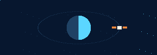

<div align="center">


# OPERACIÓN: ÚLTIMA LUZ

**LOS TIRA VIDA / 02 · JUNIOR ASTRONAUT MISSION TRAINER**

`EXPLORA · REPARA · SOBREVIVE`




</div>

```text
SOL 047 / CRÁTER JEZERO / 03:42
ENERGÍA ........ FUERA DE LÍNEA
RECICLADOR O2 .. FUERA DE LÍNEA
COMUNICACIONES . SIN SEÑAL
TRIPULANTE ..... TÚ
```

Una tormenta dejó el refugio a oscuras. Tu traje conserva oxígeno, los repuestos están dispersos y la antena sigue en el exterior.

**Operación: Última Luz** es una aventura de exploración y reparación en tiempo real con estética de 16 bits. Controlas al astronauta directamente, recorres el hábitat, recuperas piezas y restauras sistemas para solicitar extracción.

## 🎮 El plan para volver vivo

1. **Explora la base.** Cruza sus pasillos y recoge los repuestos brillantes al acercarte.
2. **Devuelve la energía.** El reactor necesita dos piezas y cuatro segundos de reparación.
3. **Asegura el refugio.** Repara el reciclador de oxígeno y el sistema de cultivos.
4. **Sal de EVA.** Rodea la base y alcanza la antena del noreste. Las tormentas consumen más oxígeno en el exterior.
5. **Pide extracción.** Con los cuatro sistemas operativos, regresa al módulo de ascenso situado al sur y prepara el despegue.

La taquilla de Control recarga el traje. El reciclador reparado recupera oxígeno dentro de la base. El reactor restaura batería. Correr consume batería; detener una reparación interrumpe su progreso.

## ⌨️ Controles

| Acción | Tecla |
| --- | --- |
| Moverse | **WASD** o **flechas** |
| Reparar / recargar / despegar | Mantener **E** cerca del equipo |
| Correr | Mantener **Shift** |
| Pausa | **P** |
| Activar o silenciar sonido | **M** |

En pantallas pequeñas aparecen una cruceta y un botón de acción táctiles. La misión se pausa si la ventana pierde el foco.

<div align="center">


</div>

## 🚀 Ejecutar en local

Con Node.js reciente y Git instalados:

```bash
git clone https://github.com/alejondr3/Lostiravida2.git
cd Lostiravida2
npm start
```

Abre **[http://127.0.0.1:4173/](http://127.0.0.1:4173/)**. No necesitas instalar dependencias.

## 🛠️ Dentro del motor

```text
src/
├── expedition-engine.js   # Colisiones, oxígeno, recursos y reparaciones
└── expedition.js          # Escenario, sprites, cámara, audio y controles
expedition.css            # Interfaz y controles táctiles
assets/                   # Banner y GIF de pixel art
scripts/                  # Generador de animaciones del README
test/expedition.test.js   # Reglas de supervivencia y extracción
server.mjs                # Servidor local sin dependencias
```

Canvas a **640 × 360**, escalado con píxeles nítidos, cámara con seguimiento y escenario de **960 × 640**. Sprites y habitaciones dibujados con código, efectos de polvo, minimapa y audio sintetizado. Las tipografías tienen respaldo local de sistema.

```bash
npm test
```

Las pruebas cubren colisiones, interrupción de reparaciones, requisitos de piezas, agotamiento y recarga de oxígeno, y extracción completa. La partida actual vive en memoria; recargar la página inicia una nueva expedición.

## 📦 Despliegue

El juego es estático y no necesita compilación. Publica la raíz que contiene `index.html` en GitHub Pages o en cualquier alojamiento estático. `server.mjs` es únicamente el servidor para desarrollo local.

---

<div align="center">

**[@alejondr3](https://github.com/alejondr3) · ARCHIVO DE EXPEDICIÓN 02**

*La base puede quedarse sin luz. Tú todavía puedes volver.*

</div>
